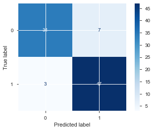
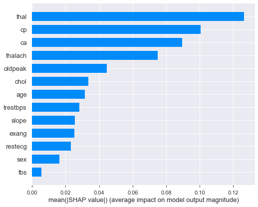
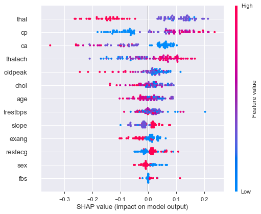
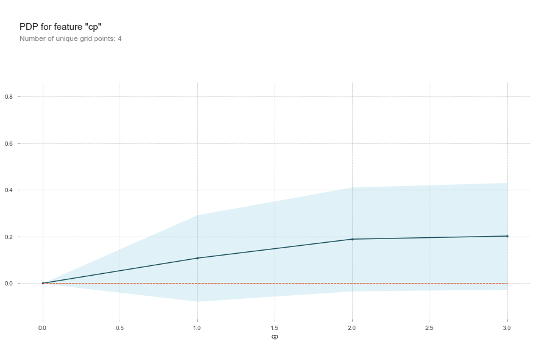

# Heart Disease Prediction with Ensemble Learning & Explainable AI

Predicting the presence of heart disease from 13 clinical measurements, comparing six classical and ensemble models, and using **SHAP**, **permutation importance**, and **partial dependence plots** to explain *why* the model makes each prediction.

In healthcare, a prediction is only useful if a clinician can trust it. This project goes beyond accuracy to show which risk factors drive the model's decisions both across the whole dataset and for individual patients.


---

## Highlights

- **89.0% test accuracy** with a Random Forest that identifies **94% of patients with heart disease** (47 of 50) on the held-out test set
- Benchmarked **6 models**: Naive Bayes, Bagging, Voting, AdaBoost, Random Forest, and a tuned Random Forest pipeline
- Built a **feature selection + hyperparameter tuning pipeline** with `SelectFromModel` and `GridSearchCV`
- Explained predictions globally and per-patient with **SHAP force plots**, **permutation importance (ELI5)**, and **partial dependence plots (PDPbox)**

---

## Dataset

The [UCI Heart Disease dataset](https://archive.ics.uci.edu/dataset/45/heart+disease) (Cleveland subset): **303 patients, 13 features**, and a binary target (heart disease present or not). Classes are reasonably balanced (165 / 138) and there are no missing values.

| Feature | Description |
|---|---|
| `age`, `sex` | Patient demographics |
| `cp` | Chest pain type (4 categories) |
| `trestbps` | Resting blood pressure (mm Hg) |
| `chol` | Serum cholesterol (mg/dl) |
| `fbs` | Fasting blood sugar > 120 mg/dl |
| `restecg` | Resting ECG results |
| `thalach` | Maximum heart rate achieved |
| `exang` | Exercise-induced angina |
| `oldpeak` | ST depression induced by exercise |
| `slope` | Slope of the peak exercise ST segment |
| `ca` | Number of major vessels colored by fluoroscopy |
| `thal` | Thalassemia test result |

---

## Approach

1. **Exploratory analysis:** automated profiling report (pandas-profiling) to check distributions, correlations, and data quality
2. **Train/test split:** 70/30 split, giving 212 training and 91 held-out test patients
3. **Model benchmarking:** each model evaluated with K-fold cross-validation on the training set, then on the untouched test set
4. **Feature selection and tuning:** a `Pipeline` combining Random Forest-based feature selection with a Random Forest classifier, tuned over tree count and split criterion with `GridSearchCV`
5. **Explainability:** SHAP, permutation importance, and partial dependence analysis on the Random Forest model

---

## Results

| Model | Cross-validation accuracy | Test accuracy |
|---|:---:|:---:|
| Gaussian Naive Bayes | 78.3% | 85.7% |
| Bagging (SVC) | 63.2% | 68.1% |
| Voting (Logistic Regression + Decision Tree + SVC) | 78.2% | 87.9% |
| AdaBoost | 80.7% | 85.7% |
| **Random Forest (500 trees)** | **80.7%** | **89.0%** |
| Random Forest + feature selection (GridSearchCV) | 76.0% | 86.8% |

The **Random Forest** performed best, with 94% recall on the heart disease class. In a screening context, that matters most: a missed diagnosis is far more costly than a false alarm.

<p align="center">
  
</p>

**Observations**

- The Bagging ensemble with SVC base learners underperformed because SVMs are sensitive to feature scale, and the features were not standardized. Adding a `StandardScaler` step would likely close most of that gap.
- Feature selection reduced the model to **8 of 13 features** (age, cp, trestbps, chol, thalach, oldpeak, ca, thal) at a small cost in accuracy, a useful trade-off where fewer required measurements simplify clinical use.
- With only 303 patients, results vary noticeably across folds, so differences of a few percentage points between models should be read with caution.

---

## Explainability


SHAP values show that **thalassemia result (`thal`)**, **chest pain type (`cp`)**, **number of major vessels (`ca`)**, and **maximum heart rate (`thalach`)** have the largest influence on predictions.

<p align="center">
  
  
</p>

The summary plot (right) also shows the *direction* of each effect. For example, higher maximum heart rate pushes predictions toward heart disease in this dataset, while more blocked major vessels (`ca`) push them away from it.

Partial dependence plots show how the predicted probability shifts as one feature changes while the others are held constant. Here, higher chest pain categories steadily increase predicted risk.

<p align="center">
  
</p>

### Why did the model flag *this* patient?

The notebook includes a `heart_disease_risk_factors()` function that produces a **SHAP force plot for an individual patient**, showing which of their measurements pushed their risk up or down. This is the kind of explanation a clinician could review alongside the prediction.

---

## Project Structure

```
├── input/
│   └── heart.csv                  # UCI Heart Disease dataset
├── output/                        # Generated profiling report and tree visualization
├── images/                        # Figures used in this README
├── Heart_disease_ensemble.ipynb   # Full analysis notebook
└── README.md
```

---

## How to Run

```bash
git clone https://github.com/sk28352/<repo-name>.git
cd <repo-name>
pip install pandas numpy scikit-learn matplotlib shap eli5 pdpbox pandas-profiling
jupyter notebook Heart_disease_ensemble.ipynb
```

> **Note:** The notebook was built with Python 3.7 and scikit-learn 0.22. Some functions it uses (such as `plot_confusion_matrix`) have since been removed from newer library versions.

---

## Future Work

- Standardize features so scale-sensitive models (SVC, Logistic Regression) compete fairly
- Use stratified, shuffled K-fold cross-validation for more stable estimates
- Report precision, recall, F1, and ROC-AUC alongside accuracy
- Update the code for current scikit-learn, SHAP, and PDPbox versions
- Deploy an interactive app where users enter patient values and see the prediction with its SHAP explanation

---

## Author

**Shruthi Kannan** · MS Computer Science, Northeastern University
[LinkedIn](https://www.linkedin.com/in/shruthi-kannan-69924624a/) · [GitHub](https://github.com/sk28352)
